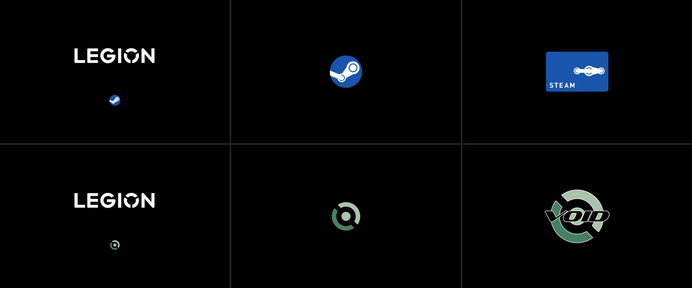
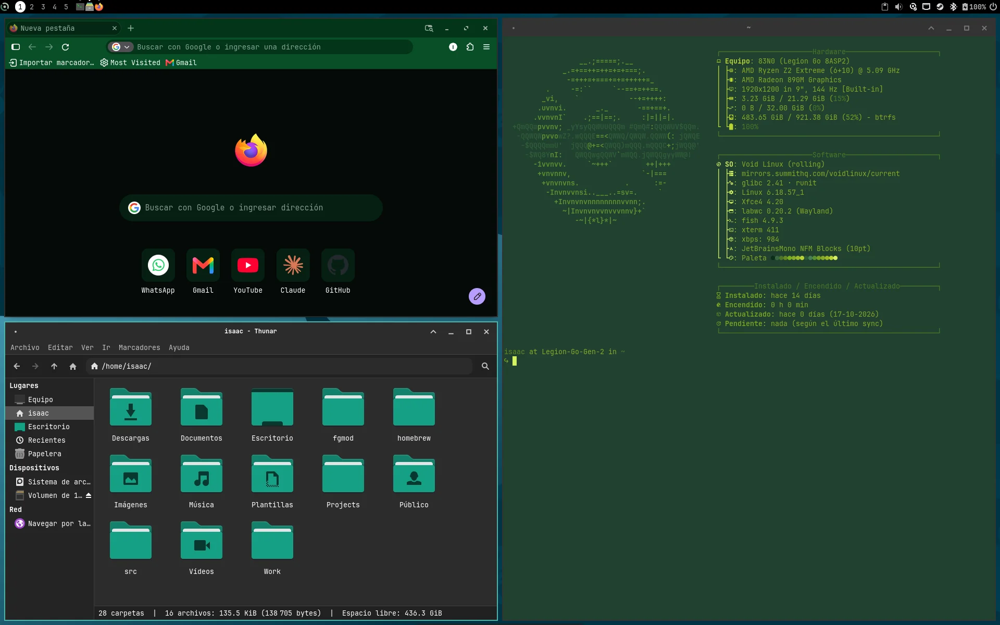
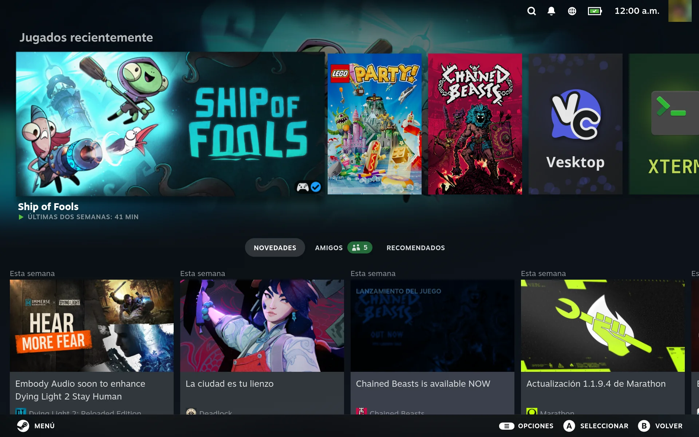

# void-legion-go2

[](https://github.com/isaac30503/void-legion-go2/actions/workflows/ci.yml)

**Void Linux + Xfce on the Lenovo Legion Go 2**, set up like SteamOS: the complete reinstall recipe, every
script and configuration it uses, and the tools to apply it — so that a reinstall gives **the same
system**, step by step, without inferring anything.

What the machine ends up with: Void (glibc, runit) with Xfce on Wayland (labwc) and Xfce X11 as a backup;
**Game Mode like SteamOS** (gamescope on the screen, Steam's SteamOS interface, autologin into the last
mode, switching without password, clean Steam shutdown); InputPlumber (Valve controller, gyroscope),
fine **TDP** through DKMS, **steamos-manager** (patched), Decky with plugins made for SteamOS working as they are
(**systemd-compat**: `systemctl` and friends answered with runit and elogind), screen sharing in both modes (patched
wlroots portal, own chooser, SteamOS's gamescope portal, patched gamescope), a hidden GRUB and the boot and loading
animations below, `ssh-find` (SSH between the home machines by every way at once), and **`void-update`** (like
CachyOS's cachy-update: panel icon, rootless checks, notifications, Void's news, services to restart) that also
**tests whether each own patch is still needed**.



*The six boot and loading animations, drawn by the repository's own generator ([boot](docs/1-platform/3-boot.md#the-loading-animations)). Steam's logo is Valve's trademark ([THIRD_PARTY.md](THIRD_PARTY.md#inspired-by-no-code-taken)).*

> A personal setup, published as a reference: it reproduces **one** machine, not a distribution. Private values
> (MACs, UUIDs, Wi-Fi name, serial numbers, Steam account id) are written as `@NAME@`; the real ones live in
> `local.env`, which is not in this repository ([docs/sanitization.md](docs/sanitization.md)). Another Legion Go 2
> owner can fill in their own from `local.env.example`.

## What it looks like

| The desktop (Xfce on Wayland) | Game Mode (SteamOS's interface) |
|---|---|
|  |  |

More in **[the tour](docs/tour.md)**: power-on, the desktop and its window snapping, Game Mode with Decky, the controller as
a Steam Deck's, and a light and a heavy game.

## Status on the Legion Go 2 (83N0)

Verified on the hardware (checks in [docs/check.md](docs/check.md); dates in [CHANGELOG.md](CHANGELOG.md) and the private archive):

| | |
|---|---|
| Screen, Wi-Fi (MT7922), Bluetooth, speakers, battery, `platform_profile` | ✓ with Void's kernel 6.18 |
| Controllers (Valve controller through InputPlumber), body gyroscope in Steam and games | ✓ |
| Fine **TDP** from Steam (`lenovo-wmi-*` through DKMS + steamos-manager) | ✓ on 6.18 kernels only (the kernel is held in its series) |
| Suspend (`s2idle`) and hibernation | ✓ |
| Game Mode like SteamOS (gamescope on the screen, autologin into the last mode, mode switch without password) | ✓ |
| Power button like the Steam Deck (press = suspend, held = power menu) | ✓ held ~3 s (the firmware's threshold, not 1 s) |
| Screen sharing in Game Mode and on the desktop (Vesktop) | ✓ with patched gamescope and xdg-desktop-portal-wlr |
| Gyroscope of each detached controller | ✗ left as is (no `hid_lenovo_go`; the detached controllers work) |
| Windows games through Proton | ✓ (Borderlands 3, Proton 9.0-2RC; Monster Hunter Wilds) |
| Decky and its plugins made for SteamOS (Panel de Control, Colores…) | ✓ through systemd-compat |

## Start here

| | |
|---|---|
| **The documentation** | [docs/void-legion-go2.md](docs/void-legion-go2.md) — the system by layers (platform → base system → hardware → sessions → desktop → Game Mode → apps → maintenance), one page per topic: what it is, install, check, problems |
| **What it is like to use** | [docs/tour.md](docs/tour.md) — screenshots from power-on to playing, each with the page that explains it |
| **How it compares with SteamOS** | [docs/6-game-mode/4-steamos-parity.md](docs/6-game-mode/4-steamos-parity.md) — measured live against a Steam Deck, value by value: what was applied to match it, and what differs on purpose |
| **Reinstalling** | [docs/reinstall.md](docs/reinstall.md) — the order of execution, stage by stage; [install/](install/README.md) runs it (`install.sh`) |
| Checking a system | [docs/check.md](docs/check.md) |
| Names | [docs/glossary.md](docs/glossary.md) — the original was in Spanish; old name → new name of every script, command, service and file |
| Language of the messages | [docs/i18n.md](docs/i18n.md) — the scripts speak the system's language (Spanish catalog included) |
| Licenses and credits | [LICENSE](LICENSE) (MIT, this repository's own work) · [THIRD_PARTY.md](THIRD_PARTY.md) (what is not ours: code, binaries, their authors, licenses and sources) |
| Changes | [CHANGELOG.md](CHANGELOG.md) |

## Layout

```
docs/       the documentation by layers (1-platform … 8-maintenance), the tour (screenshots), reinstall, check,
            glossary, i18n, sanitization
legion/     pieces only for the Legion (system scripts, Xfce config, TDP DKMS, portal patches, screen-share…);
            legion/diag/: diagnostic scripts, not installed
common/     pieces shared with the IdeaPad (Game Mode, Xfce Wayland, power button, void-update, systemd-compat,
            ssh-find, boot animations, GRUB theme, fish…); common/diag/: diagnostic scripts
install/    the inventory (pieces.tsv: every piece, enforced by verify), fetch-assets, render, install (stages),
            migrate, secrets, verify, i18n; assets.tsv
tests/      automated tests (render, the inventory, systemd-compat, ssh-find, void-update's helpers, translations):
            bash tests/run.sh
.github/    CI: verify.sh --ci and the tests on every push
lib/        common.sh (helpers), i18n.sh and void_legion_i18n.py (translations)
locale/     message catalogs (es)
LICENSES/   license texts (SPDX) and third-party notices
```

Binaries (built `.xbps` packages, InputPlumber, steamos-manager, `libextest.so`, fonts, Orchis and Volantes)
are assets of the GitHub Release, not git: `install/fetch-assets.sh` puts them where the scripts expect them.
The Release also carries the source of the GPL ones ([THIRD_PARTY.md](THIRD_PARTY.md)). What is personal (the encrypted
`local.env`, Claude Code's context, the logs and the long history of each decision) is in a private companion repository.

## Quick start (on a freshly installed Void, as the user)

```bash
sudo xbps-install -S git
git clone https://github.com/isaac30503/void-legion-go2 ~/src/void-legion-go2 && cd ~/src/void-legion-go2
bash install/install.sh --list     # the 19 stages
bash install/install.sh            # runs them in order, stopping at reboots and manual steps
```

## Origin and authorship

Translated and organized from the Spanish documentation kept on an external disk (`Backups Linux/`); on
2026-10-14 reorganized by the system's layers. Every command, path and check of the original is here (checked
item by item); the dated notes and diagnoses are in the private archive and in the tag `recipe-single-file`.

Most of the text and code was written with **Claude Code** (Anthropic's coding agent) working on the machines
under the author's direction; commits say so (`Assisted-by: Claude Opus 5.5`). The goals, the choices (every "the user's
decision" in the documentation), the testing on the hardware and the final word on each change are the
author's; the agent proposed, wrote, diagnosed with read-only tools and documented. What is not ours at all is
credited in [THIRD_PARTY.md](THIRD_PARTY.md).

## License

This repository's own work: [MIT](LICENSE). Third-party code, patches and binaries keep their own licenses
([THIRD_PARTY.md](THIRD_PARTY.md), texts in [LICENSES/](LICENSES/)).
