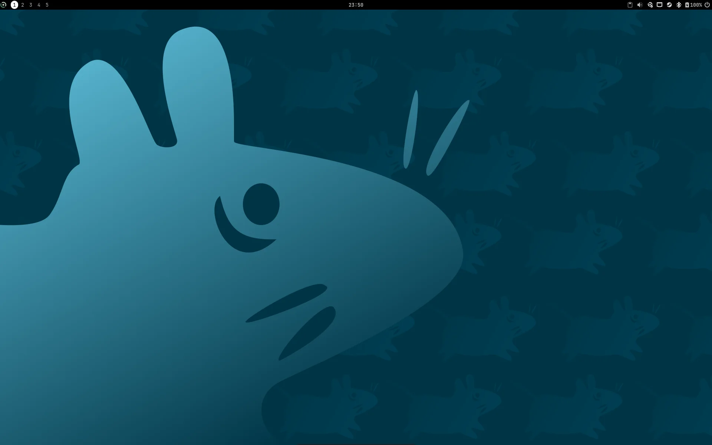
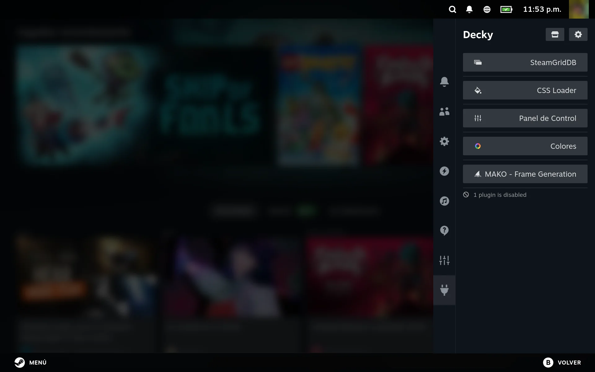
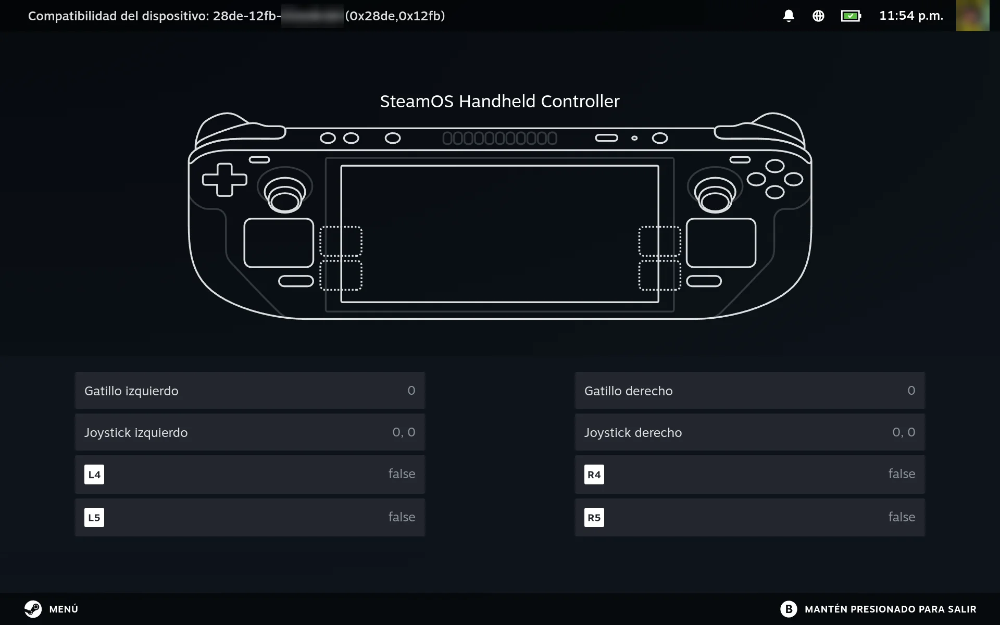
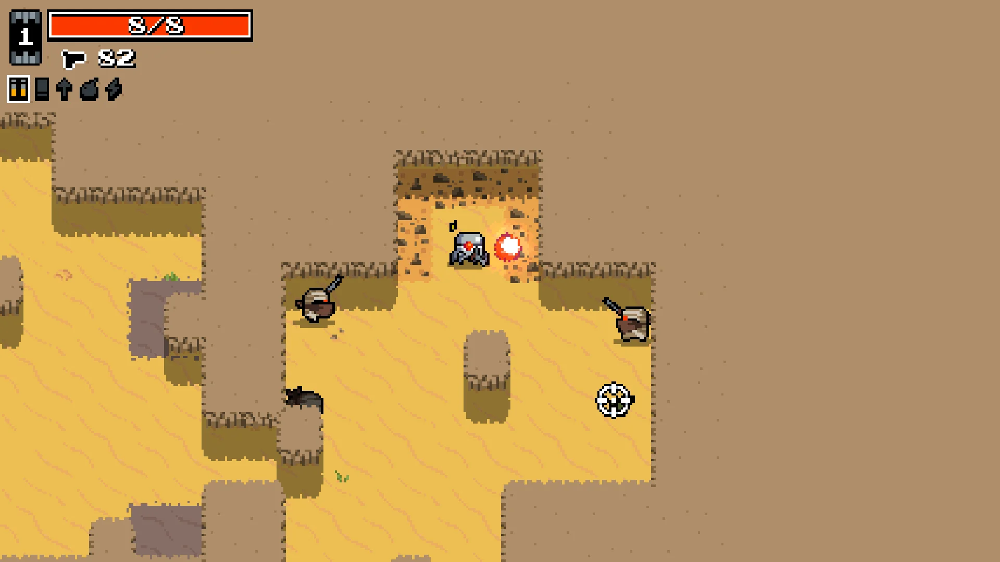
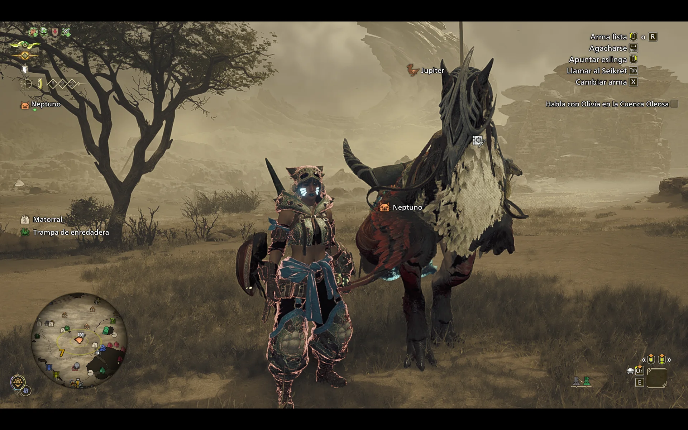

# A tour

What the Legion Go 2 is like to use with this setup, from power-on to playing. Every picture is a screenshot of the
real machine (1920×1200, October 2026; the two games run at 16:9, shown without their black bars). The interface is in
Spanish, the machine's language; the scripts follow the system's language too ([i18n](i18n.md)). The pages linked under each one explain how it is done.

## Power-on

No text scrolls by. Void's symbol spins until the session starts (bottom, center: **Void B**). Game Mode shows
Steam's large circle while Steam loads (top, center: **Steam B**). The other four are options.
[Boot](1-platform/3-boot.md#the-loading-animations)

## The desktop: Xfce, set up like a modern desktop

Xfce on Wayland (labwc), with a single bar at the top: workspaces on the left, the clock in the middle, the tray on
the right. The launcher dock stays hidden until the pointer reaches the bottom edge. Dark theme (Orchis), Papirus
icons with teal folders, one font everywhere (JetBrains Mono): still Xfce underneath, with a current look. [Xfce](5-desktop/1-xfce.md), [look and feel](5-desktop/2-look-and-feel.md)

Windows are placed from the keyboard, like a tiling desktop but without forcing it. Super+Shift+arrows snaps a window
to a half; a second arrow takes it to a corner. Every gap is the same 8 px. Super+arrows moves the focus to the
window on that side. New windows open almost maximized. Here: Firefox and Thunar in the left quarters, a terminal on
the right half. [Windows and shortcuts](5-desktop/3-windows-and-shortcuts.md)

## Game Mode: SteamOS's interface

The same Game Mode as a Steam Deck: gamescope drives the screen directly, Steam runs its SteamOS interface, and the
machine starts in whichever mode was used last, without a login screen. Desktop apps can live here as well: Vesktop
(Discord) and xterm have their own library art, made by the repository's generators.
[Game Mode](6-game-mode/2-game-mode.md), [library art](6-game-mode/6-library-art.md),
[how it compares with SteamOS](6-game-mode/4-steamos-parity.md)

Decky Loader in the quick menu, as on SteamOS, with its plugins: art for the library, themes, TDP, fans and controls
(Panel de Control), the controllers' lights (Colores), frame generation (MAKO). Plugins written for SteamOS work as
they are, because systemd-compat answers what they ask of systemd.
[Decky](6-game-mode/5-decky.md), [systemd-compat](2-base-system/4-systemd-compat.md)

Steam sees the Legion's built-in controls as a **Steam Deck controller** ("SteamOS Handheld Controller"), exactly as
on SteamOS: the back buttons (L4, L5, R4, R5), the touchpad and the body's gyroscope, all available to Steam Input.
InputPlumber joins them into that one virtual controller. [Controllers](3-hardware-support/1-controllers.md)

## Playing: from a light game to a heavy one

A light game: Nuclear Throne, which needs little power, so the TDP can be lowered from Steam's own performance menu
to make the battery last.
[Power](3-hardware-support/2-power.md), [steamos-manager](6-game-mode/3-steamos-manager.md)

A demanding one: Monster Hunter Wilds, a Windows game, through Proton, on the Radeon 890M with Mesa from Void's
repositories; the same menu raises the TDP when a game needs it. [Steam](6-game-mode/1-steam.md),
[SteamOS parity](6-game-mode/4-steamos-parity.md)

---

Steam, its interface and its logo are Valve's; the games and their art belong to their publishers (Nuclear Throne:
Vlambeer; Monster Hunter Wilds: Capcom); the desktop's wallpaper is Xfce's own `xfce-mouserace.svg` (xfdesktop).
The screenshots only show them in use ([THIRD_PARTY.md](../THIRD_PARTY.md)). The Steam avatar and the controller's
serial-like id are blurred.
